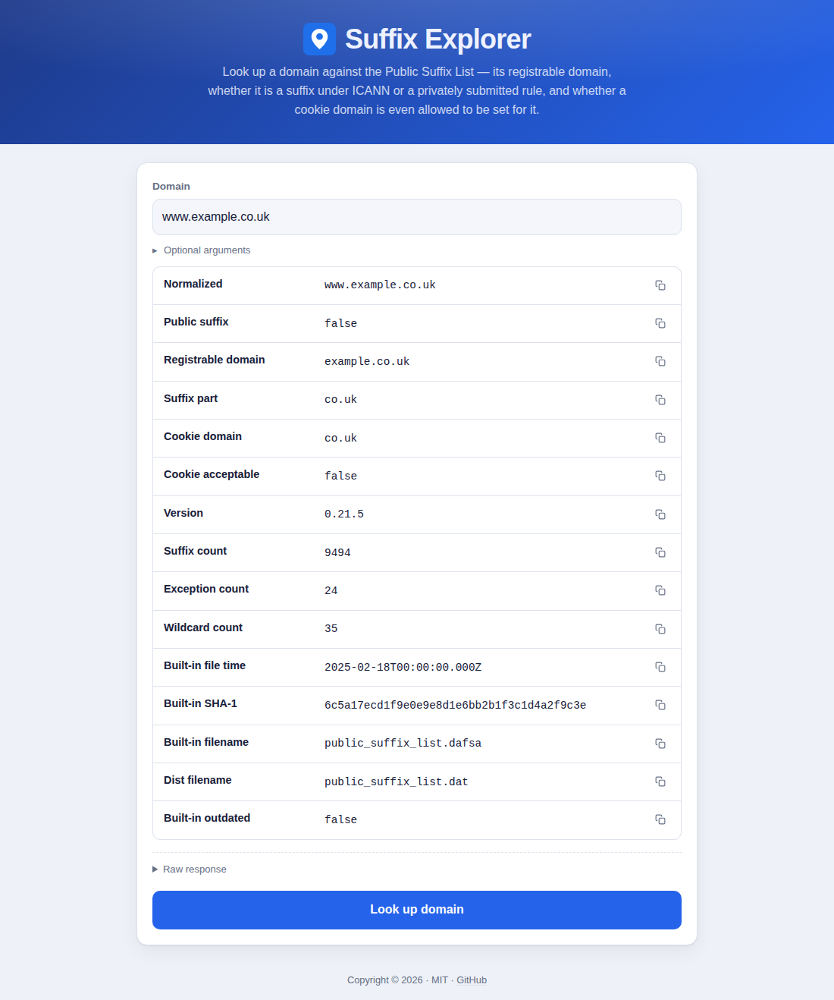

# Suffix Explorer

A TypeScript + React web UI that exercises **every libpsl feature** — UTF-8
_normalizing_ a domain, checking whether it _is a public suffix_, splitting
it into its _registrable domain_ and _suffix part_, deciding whether a
_cookie domain_ is acceptable for a hostname, and inspecting the compiled-in
_library info_ — all in one request to a single JSON endpoint, `POST /psl`.

The server here is a **zero-dependency emulation** that returns hardcoded JSON.
An admin page lets you switch which JSON it returns.



```
pubsuffix-wla/
├── src/            client source (TypeScript + React)
├── public/         static assets copied verbatim into dist/ (favicon.svg)
├── docs/           README assets (screenshot.png)
├── index.html      Vite entry HTML
├── dist/           BUILD OUTPUT — client files only: index.html, app.js, app.css, favicon.svg
├── server/         emulation server (plain JS, Node built-ins only)
│   ├── server.js
│   ├── admin.html  preset picker UI — part of the server
│   ├── presets.json
│   └── state.json  which preset/custom JSON is active (mutated by admin)
├── vite.config.ts
├── tsconfig*.json
└── package.json    all deps in devDependencies
```

## Install

```bash
npm install
```

Every dependency is a **devDependency** — React/ReactDOM are bundled into the
static client at build time, and the server needs nothing.

## Develop (two terminals)

```bash
npm run server   # emulation API + admin on http://localhost:3001
npm run dev      # Vite UI on http://localhost:5173 (proxies /api → :3001)
```

Open <http://localhost:5173> — this is the user-facing service (domain input,
results, options). It has **no link to the admin page**.

The admin page is a **server-operator tool**, reached directly at
<http://localhost:3001/admin.html>, and only configures what the emulation
server returns.

## Build + run as one server

```bash
npm run start        # = npm run build && npm run server
```

`npm run build` emits **only client files** into `dist/`:

| file            | source                                  |
| --------------- | --------------------------------------- |
| `index.html`    | `index.html` (processed by Vite)        |
| `app.js`        | bundled `src/**` + React                |
| `app.css`       | bundled `src/styles.css`                |
| `favicon.svg`   | `public/favicon.svg` (copied verbatim)  |

Then `npm run server` serves that `dist/` at <http://localhost:3001/> and the
JSON API from the same origin.

## JSON API

There is a single endpoint, `POST /psl`, that does exactly one thing —
`domain_info` (request/response shapes are in `src/types.ts`, and mirror
libpsl's public entry points in `build/package/include/libpsl.h`). The
request body carries its arguments directly; there is no `method` field
left to discriminate on.

### `domain_info`

Normalizes `domain` (UTF-8 lowercasing — the same step libpsl runs
internally before comparing against the suffix list, `encoding` is optional
and defaults to assuming `domain` is already UTF-8), then checks and splits
the *normalized* form: whether it is a public suffix (`types` selects which
`PSL_TYPE_*` bits to test — `icann`, `private`, `no_star_rule`; omitted or
empty falls back to libpsl's own default of `icann` + `private`), its
registrable part (the shortest part someone can actually own, absent if the
domain is not registrable at all — e.g. it is already a public suffix), and
its suffix part (the longest public-suffix part, absent if none was found).

An optional `cookie_domain` folds in a further check: whether a site serving
`domain` (its normalized form, as hostname) may set a cookie scoped to
`cookie_domain` — false whenever `cookie_domain` reaches up into a public
suffix. `cookie_domain` and `cookie_domain_acceptable` are present in the
response only when `cookie_domain` was given in the request.

Every response also reports the compiled-in suffix list's own metadata —
version, rule counts, and whether it looks outdated against upstream — since
that costs nothing extra to compute. `builtin_file_time`, `builtin_sha1sum`,
`builtin_filename` and `dist_filename` are each absent rather than `null`
when libpsl has no value for them.

```jsonc
// request
{ "domain": "www.example.co.uk", "cookie_domain": "co.uk" }
// response
{
  "domain": "www.example.co.uk",
  "normalized": "www.example.co.uk",
  "is_public_suffix": false,
  "registrable_domain": "example.co.uk",
  "unregistrable_domain": "co.uk",
  "cookie_domain": "co.uk",
  "cookie_domain_acceptable": false,
  "version": "0.21.5",
  "suffix_count": 9494,
  "suffix_exception_count": 24,
  "suffix_wildcard_count": 35,
  "builtin_file_time": 1739836800,
  "builtin_sha1sum": "6c5a17ecd1f9e0e9e8d1e6bb2b1f3c1d4a2f9c3e",
  "builtin_filename": "public_suffix_list.dafsa",
  "dist_filename": "public_suffix_list.dat",
  "builtin_outdated": false
}
```

Every response also carries an `_emulation` block echoing the request and the
active preset.

## Admin page (server operators only)

`server/admin.html` is part of the server, served at `/admin.html`. It is **not**
reachable from the user-facing UI. It lists the presets in `server/presets.json`
per method plus a **Custom JSON** box. "Save" writes the choice to
`server/state.json`; the next API call uses it immediately.

## Swapping in the real libpsl

`npm run dev` + `npm run server` is the client-only path described above: a
zero-dependency Node server standing in for the real backend so the UI can be
built and exercised on its own. The real WLA module already exists in this
repo — `module.c` calls into `libpsl.h` directly to answer the same
`domain_info` request, and `server.c` wires it up as the actual server, both built via
`npm run bitmake`. The wire contract in `src/types.ts` is all either backend
has to agree on; swapping which one is running never touches the client.
